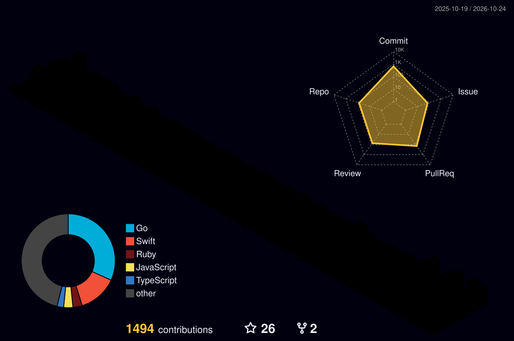

  

 

 

Hey, I'm Om. I'm a founding engineer at Ensueno, where I work on the API and the Postgres side of our services. Most of my open source work is in Go.

I'm open to new roles. The quickest way to reach me is [LinkedIn](https://linkedin.com/in/om-lahorey) or omlahorey@gmail.com.

## RemoveMacAI

[RemoveMacAI](https://github.com/omlahore/RemoveMacAI) turns off Apple Intelligence on a Mac and deletes the models it downloads. It also switches off analytics, personalized ads and a lot of the other extras macOS turns on by default, and you can undo every change. It comes as a native Mac app and a command-line tool.

It hit #1 on Hacker News, and Linus Tech Tips talked about it on [the WAN Show](https://www.youtube.com/watch?v=fKO_826EYo4&t=6564s). [The Verge](https://www.theverge.com/ai-artificial-intelligence/1004672/mac-delete-apple-intelligence-ai-tool), [Ars Technica](https://arstechnica.com/apple/2026/10/command-line-tool-quickly-removes-apple-intelligence-from-macos-27/), [The Register](https://www.theregister.com/ai-and-ml/2026/10/05/get-rid-of-apples-ai-bloatware-and-reclaim-12-gb-of-storage-with-this-open-source-tool/5301213), [MacRumors](https://www.macrumors.com/2026/10/05/apple-intelligence-removal-tool-frees-mac-storage/) and [AppleInsider](https://appleinsider.com/articles/26/10/05/dumb-down-your-mac-save-12gb-by-removing-apple-intelligence) wrote about it, and [Daring Fireball](https://daringfireball.net/linked/2026/10/06/cli-tool-removes-apple-intelligence-from-macos-27) linked to it.

 

  

<a href="https://github.com/omlahore/RemoveMacAI"><picture>
  <source media="(prefers-color-scheme: dark)" srcset="https://raw.githubusercontent.com/omlahore/RemoveMacAI/main/docs/screens/overview-dark.webp" />
  
</picture></a>

## Open source

I've had 60+ pull requests merged in more than 25 projects, most of them Go infrastructure. These are the ones I work in the most:

I've also had PRs merged in [Wayfinder](https://github.com/OneBusAway/wayfinder/pulls?q=is%3Apr+author%3Aomlahore+is%3Amerged), [Kestra blueprints](https://github.com/kestra-io/blueprints/pulls?q=is%3Apr+author%3Aomlahore+is%3Amerged), [OpenKruise agents](https://github.com/openkruise/agents/pulls?q=is%3Apr+author%3Aomlahore+is%3Amerged), [vehicle-positions](https://github.com/OneBusAway/vehicle-positions/pulls?q=is%3Apr+author%3Aomlahore+is%3Amerged), [go-gtfs](https://github.com/OneBusAway/go-gtfs/pulls?q=is%3Apr+author%3Aomlahore+is%3Amerged), [Twenty](https://github.com/twentyhq/twenty/pulls?q=is%3Apr+author%3Aomlahore+is%3Amerged), [PipeCD](https://github.com/pipe-cd/pipecd/pulls?q=is%3Apr+author%3Aomlahore+is%3Amerged), [MDN](https://github.com/mdn/content/pulls?q=is%3Apr+author%3Aomlahore+is%3Amerged), [Stagehand](https://github.com/browserbase/stagehand/pulls?q=is%3Apr+author%3Aomlahore+is%3Amerged), [KHI](https://github.com/GoogleCloudPlatform/khi/pulls?q=is%3Apr+author%3Aomlahore+is%3Amerged), [Phase](https://github.com/phasehq/console/pulls?q=is%3Apr+author%3Aomlahore+is%3Amerged), [OpenWISP](https://github.com/openwisp/openwisp-radius/pulls?q=is%3Apr+author%3Aomlahore+is%3Amerged), [AxonHub](https://github.com/looplj/axonhub/pulls?q=is%3Apr+author%3Aomlahore+is%3Amerged), [tweakcn](https://github.com/jnsahaj/tweakcn/pulls?q=is%3Apr+author%3Aomlahore+is%3Amerged), [dashbrr](https://github.com/autobrr/dashbrr/pulls?q=is%3Apr+author%3Aomlahore+is%3Amerged), [ghorg](https://github.com/gabrie30/ghorg/pulls?q=is%3Apr+author%3Aomlahore+is%3Amerged) and [gickup](https://github.com/cooperspencer/gickup/pulls?q=is%3Apr+author%3Aomlahore+is%3Amerged).

I reported three crypto bugs privately to an end to end encrypted photo service in Europe as well. The worst one was a PBKDF2 iteration count that dropped to a single round on 32 bit builds, and they confirmed all three and had fixes out the same day.

## Stack

## Activity

## Writing

- [Apple deprecated the settings that lock Apple Intelligence off. macOS 27 still honors them](https://medium.com/@omlahore47/apple-deprecated-the-settings-that-lock-apple-intelligence-off-macos-27-still-honors-them-2a5a914e0efb)
- [macOS 27 has no Apple Intelligence off switch, so here's what actually turns it off](https://medium.com/@omlahore47/macos-27-has-no-apple-intelligence-off-switch-so-heres-what-actually-turns-it-off-c9b74d139a98)
- [automaxprocs now costs your Go binary a CPU](https://medium.com/@omlahore47/automaxprocs-now-costs-your-go-binary-a-cpu-61d63a12e3ec)
- [Dead dependencies don't get archived. They get quiet.](https://medium.com/@omlahore47/dead-dependencies-dont-get-archived-they-get-quiet-5916613a7a39)
- [Your local agent is spending 39% of its system prompt on skills it will never use](https://medium.com/@omlahore47/your-local-agent-is-spending-39-of-its-system-prompt-on-skills-it-will-never-use-232f6515515c)
- [shadPS4 shipped 239 commits and none of them say "fix memory leak"](https://medium.com/@omlahore47/shadps4-shipped-239-commits-and-none-of-them-say-fix-memory-leak-a61f32b5cbd8)

